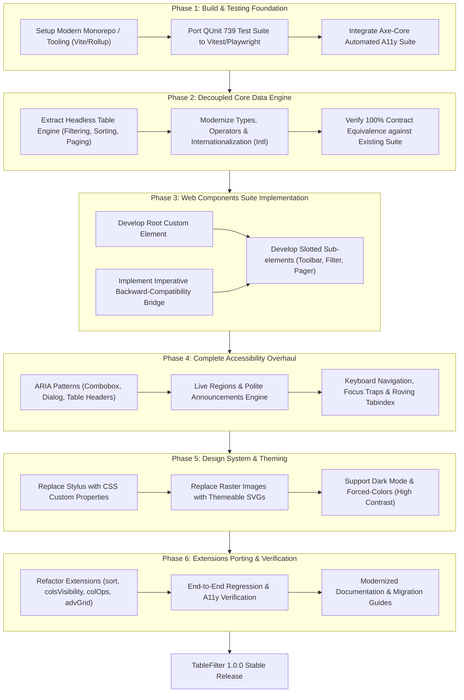

# TableFilter v1.0.0 Architecture & Migration Investigation
## Transition to Native Web Components, Universal Accessibility (WCAG 2.2), and Complete Contract Compatibility

---

## Executive Summary

**TableFilter** (currently at `v0.7.3`) is a mature, battle-tested JavaScript library that transforms standard HTML tables into rich, interactive data tables with column filtering, sorting, pagination, and calculations. It is backed by extensive documentation (Wiki, ESDoc, demos) and a 74-file test suite comprising 739 test cases that define an exacting operational contract.

Transitioning TableFilter to **Version 1.0.0** represents a milestone evolution:
1. **Native Web Components**: Adopting W3C Standard Custom Elements (`<table-filter>`) with Shadow DOM encapsulation and slot projection, eliminating framework lock-in and script tag fragility.
2. **Universal Accessibility (WCAG 2.2 AA/AAA & WAI-ARIA APG)**: Resolving critical accessibility shortcomings in legacy versions (unlabeled inputs, inaccessible sort triggers, custom checklists without ARIA widget semantics, silent state transitions) to make every filter, modal, and data view completely operable by screen readers and keyboard users.
3. **100% Contract Preservation**: Fulfilling the entire configuration schema, imperative API (`new TableFilter(...)`), event emitter lifecycle, and extension ecosystem documented across the project specifications.

---

## 1. Contract Analysis: The Baseline Specification

The TableFilter specification consists of three core layers documented in the wiki, codebase, and tests:

```
+-----------------------------------------------------------------------+
|                         CONSUMER INTERFACE                            |
|  Declarative: <table-filter>      |  Imperative: new TableFilter(...) |
+-----------------------------------+-----------------------------------+
|                           PUBLIC API                                  |
|  Methods (init, filter, clear)    |  Events (before-filtering, etc.)  |
+-----------------------------------+-----------------------------------+
|                      CONFIGURATION CONTRACT                           |
|  Main Options (col_types, etc.)   |  Feature Blocks (paging, etc.)    |
+-----------------------------------+-----------------------------------+
|                      EXTENSIONS ECOSYSTEM                             |
|  sort  |  colsVisibility  |  filtersVisibility  |  colOps  | advGrid  |
+-----------------------------------------------------------------------+
|                      DATA & FILTERING ENGINE                          |
|  Operators (<, >, =, rgx:)        |  Type Formats (date, num, regex)  |
+-----------------------------------------------------------------------+
```

### 1.1 Constructor & Instantiation Contract
- **Signatures**:
  - `new TableFilter(tableElement: HTMLTableElement, [refRow: number], [config: object])`
  - `new TableFilter(tableId: string, [refRow: number], [config: object])`
- **Behavior**:
  - Validates table presence; extracts or generates instance ID (`tf.id`).
  - Sets up `refRow` (default index `0` or `1` depending on headers and filters row placement).
  - Normalizes legacy/shorthand configurations into normalized internal structures.
  - Registers modules/features in the feature registry.
  - Registers extensions in the extension registry.

### 1.2 Configuration Schema Contract
The library contract defines over 100 configuration properties across 20 distinct modules:

| Functional Area | Primary Configuration Properties | Expected Behavior |
| :--- | :--- | :--- |
| **Grid & Filters Row** | `grid`, `filters_row_index`, `col_{n}`, `col_types`, `auto_filter`, `enter_key` | Controls filter type per column (`input`, `select`, `multiple`, `checklist`, `none`), row index (0=above headers, 1=below), debounce delay. |
| **Data Matching** | `exact_match`, `columns_exact_match`, `case_sensitive`, `ignore_diacritics`, `empty_operator`, `nonempty_operator` | Controls string normalization, regex parsing, empty/non-empty matching tokens. |
| **Data Types & Locales** | `col_types`, `locale`, `thousands_separator`, `decimal_separator` | Formatted numbers (`1.234,56` vs `1,234.56`), ISO & localized dates (`{dd}.{MM}.{yyyy}`). |
| **Dropdown & Checklist** | `enable_slc_reset_filter`, `load_filters_on_demand`, `sort_filter_options_asc`, `custom_options` | Populates unique values from column cells; handles linked/cascading filter state. |
| **Pagination** | `paging`, `paging_length`, `results_per_page`, `page_selector_type`, `has_nb_pages` | Chunks visible rows into pages, renders navigation buttons and jump selectors. |
| **Toolbar & Containers** | `toolbar`, `rows_counter`, `status_bar`, `btn_reset`, `loader`, `help_instructions` | Creates multi-zone toolbar (`left`, `center`, `right`) with live counters, reset button, and status text. |
| **State Persistence** | `state.types` (`'local_storage'`, `'cookie'`, `'hash'`), `state.filters`, `state.page_nb` | Serializes and restores filter strings, page indices, and column visibility. |
| **Extensions** | `extensions: [{ name: 'sort' }, { name: 'colsVisibility' }, ...]` | Asynchronously loads/initializes extension packages. |

### 1.3 Public API & Event Emitter Contract
- **Essential Methods**:
  - Filtering: `filter()`, `clearFilters()`, `setFilterValue(colIndex, value)`, `getFilterValue(colIndex)`, `getFiltersValue()`.
  - Introspection: `getFilteredData()`, `getTableData()`, `getValidRows()`, `getValidRowsNb()`, `getFilterableRowsNb()`, `getCellValue(cell)`, `getCellData(cell)`.
  - DOM References: `dom()`, `getFilterElement(colIndex)`, `getHeaderElement(colIndex)`, `getFiltersRowIndex()`, `getHeadersRowIndex()`.
  - Lifecycle: `init()`, `destroy()`, `isInitialized()`, `feature(name)`, `extension(name)`, `registerExtension(inst, name)`.
- **Event Lifecycle**:
  - Sequential event bus firing:
    `before-filter-init` &rarr; `filters-row-inserted` &rarr; `after-filter-init` &rarr; `initialized` &rarr; `before-filtering` &rarr; `cell-processed` &rarr; `row-processed` &rarr; `row-validated` &rarr; `after-filtering` &rarr; `before-clearing-filters` &rarr; `after-clearing-filters` &rarr; `destroy`.

### 1.4 Operator & Query Parsing Contract
- Standard comparison operators: `<`, `<=`, `=`, `>=`, `>`.
- Logical & matching operators: `*` (contains/wildcard), `!` (negation), `{` (starts with), `}` (ends with), `||` (OR), `&&` (AND), `rgx:` (regular expression).
- Null state operators: `[empty]`, `[nonempty]`.

---

## 2. Native Web Components Architecture for v1.0.0

### 2.1 Autonomous Custom Elements vs. Customized Built-in Elements
In the HTML Web Components specification, two approaches exist:
1. **Customized built-in element**: `<table is="table-filter">`.
   - *Limitation*: Apple/WebKit has refused to implement customized built-in elements (`is=""`) in Safari. Polyfills are brittle and do not conform to native standards.
2. **Autonomous custom element**: `<table-filter>`.
   - *Advantage*: Supported universally across all modern browsers (Chrome, Edge, Firefox, Safari, iOS, Android).
   - *Structure*: Wraps or references the native `<table>` element using slots.

```html
<!-- Declarative Pattern 1: Table Slotted Inside Custom Element (Recommended) -->
<table-filter paging auto-filter theme="default">
  <table id="my-table">
    <thead>
      <tr><th>From</th><th>Destination</th><th>Distance</th></tr>
    </thead>
    <tbody>
      <tr><td>Sydney</td><td>Melbourne</td><td>877</td></tr>
    </tbody>
  </table>
</table-filter>

<!-- Declarative Pattern 2: External Reference via 'for' Attribute -->
<table-filter for="my-table" paging></table-filter>
<table id="my-table">...</table>
```

### 2.2 Shadow DOM vs. Light DOM: Accessibility & Semantics
HTML `<table>` semantics are strictly parsed by browser layout and accessibility engines:
- `<table>` elements **must not** contain custom elements as direct children between `<table>`, `<tbody>`, and `<tr>`.
- Placing the table in the Light DOM (projected via `<slot>` into `<table-filter>`) ensures:
  1. Accessibility tree integrity: Screen readers parse the native table header-to-cell relationships without shadow boundary clipping.
  2. Consumer CSS styling: Global application stylesheets (Bootstrap, Tailwind, custom design systems) continue to style table rows and cells naturally.
  3. Progressive enhancement: If JavaScript is disabled or fails to load, the raw HTML table remains fully rendered and legible.

```
+-------------------------------------------------------------+
| <table-filter> (Host Custom Element)                       |
|                                                             |
| [ Shadow DOM ]                                              |
| +---------------------------------------------------------+ |
| | <tf-toolbar part="toolbar-top">                         | |
| |   <slot name="top-toolbar">                             | |
| |     <tf-status part="status" role="status"></tf-status> | |
| |     <tf-rows-counter part="counter"></tf-rows-counter>  | |
| |     <tf-clear-button part="clear-btn"></tf-clear-button>| |
| |   </slot>                                               | |
| | </tf-toolbar>                                           | |
| +---------------------------------------------------------+ |
| | <div class="table-container" part="table-container">   | |
| |   <slot></slot>  <------------------------------------+ | |
| | </div>                                                | | |
| +-------------------------------------------------------|-+ |
| | <tf-toolbar part="toolbar-bottom">                    | | |
| |   <slot name="bottom-toolbar">                        | | |
| |     <tf-pager part="pager"></tf-pager>                | | |
| |   </slot>                                             | | |
| | </tf-toolbar>                                         | | |
| +-------------------------------------------------------|-+ |
|                                                         |   |
| [ Light DOM (Slotted Content) ]                         |   |
| +-------------------------------------------------------|-+ |
| | <table id="my-table"> <-------------------------------+ | |
| |   <thead>                                               | |
| |     <tr class="tf-headers-row">...</tr>                 | |
| |     <tr class="tf-filters-row">                         | |
| |       <th><tf-filter-input col="0"></tf-filter-input></th>|
| |       <th><tf-checklist col="1"></tf-checklist></th>   | |
| |       <th><tf-dropdown col="2"></tf-dropdown></th>     | |
| |     </tr>                                               | |
| |   </thead>                                              | |
| |   <tbody>...</tbody>                                    | |
| | </table>                                                | |
| +---------------------------------------------------------+ |
+-------------------------------------------------------------+
```

### 2.3 Modular Component Suite
v1.0.0 decomposes the monolithic script into focused custom elements:

1. `<table-filter>`: Root orchestrator, state manager, and public API provider.
2. `<tf-toolbar>`: Multi-section flex container (`left`, `center`, `right`) managing UI controls.
3. `<tf-filter-input>`: Accessible search input with integrated debounce, clear button, and operator help popover.
4. `<tf-dropdown>`: Accessible native `<select>` wrapper with dynamic option collection.
5. `<tf-checklist>`: Accessible ARIA Combobox/Listbox multi-select popup with search, select-all, and keyboard navigation.
6. `<tf-pager>`: Accessible pagination component with WAI-ARIA buttons, page indicator, and results-per-page selector.
7. `<tf-status>`: Accessible live status announcements (`role="status"`, `aria-live="polite"`).
8. `<tf-rows-counter>`: Live region counter displaying total and filtered row counts.
9. `<tf-clear-button>`: Accessible reset button dispatching filter reset actions.
10. `<tf-dialog>`: Accessible modal/popover container for help instructions, column visibility manager, and popup filters.

### 2.4 Dual API Architecture (Declarative + Imperative Backward Compatibility)
To guarantee 100% backward compatibility for existing codebases:

```javascript
// Legacy Imperative Instantiation remains fully supported:
const tf = new TableFilter(document.querySelector('#my-table'), {
    base_path: 'dist/tablefilter/',
    paging: true,
    col_types: ['string', 'number', 'date']
});
tf.init();

// Under the hood:
// 1. TableFilter class wraps or mounts the <table-filter> custom element.
// 2. All legacy methods (filter, clearFilters, getFilteredData, etc.) proxy directly
//    to the underlying web component controller.
// 3. Emitter events and DOM CustomEvents are synchronized bidirectionally.
```

---

## 3. Comprehensive Accessibility (A11y) Strategy

### 3.1 Standards & Conformance Targets
- **Conformance Target**: WCAG 2.2 Level AA (Level AAA where feasible).
- **ARIA Specifications**: WAI-ARIA 1.2 / 1.3 & WAI-ARIA Authoring Practices Guide (APG) Table and Data Grid patterns.
- **Section 508 & EN 301 549**: Fully aligned.

### 3.2 Component-by-Component Accessibility Implementation

#### 1. Sortable Column Headers
*Legacy Problem*: `<th>` click listeners with cursor pointer; no keyboard access, no state announcement for screen readers.
*v1.0.0 Implementation*:
- Interactive trigger inside `<th>`:
  ```html
  <th scope="col" aria-sort="ascending">
    <button type="button" class="tf-sort-btn" id="sort-col-0">
      <span>Destination</span>
      <svg class="tf-sort-icon" aria-hidden="true" focusable="false">...</svg>
    </button>
  </th>
  ```
- Attributes: `aria-sort="none"`, `aria-sort="ascending"`, or `aria-sort="descending"`.
- Keyboard: `Enter` or `Space` toggles sort direction.
- Screen Reader Output: *"Destination, sortable column, sorted ascending. Activate to sort descending."*

#### 2. Filter Inputs
*Legacy Problem*: Plain `<input type="text">` without label, `aria-label`, or relationship to column headers.
*v1.0.0 Implementation*:
```html
<th scope="col">
  <div class="tf-filter-wrap">
    <label for="flt-0-input" class="sr-only">Filter Destination</label>
    <input 
      type="search" 
      id="flt-0-input"
      class="tf-filter-input"
      aria-label="Filter Destination"
      aria-describedby="flt-0-desc"
      placeholder="Filter..."
      autocomplete="off"
      spellcheck="false"
    />
    <span id="flt-0-desc" class="sr-only">Supports operators like >, <, =, and wildcard *</span>
    <button type="button" class="tf-clear-filter-btn" aria-label="Clear Destination filter">
      <svg aria-hidden="true">...</svg>
    </button>
  </div>
</th>
```

#### 3. Checklist Multi-Select Filter
*Legacy Problem*: Plain `<div>` with `<ul>`/`<li>` and checkboxes, unnavigable via arrow keys, not adhering to combobox pattern.
*v1.0.0 Implementation (WAI-ARIA Combobox / Listbox Pattern)*:
- Trigger Button:
  ```html
  <button 
    type="button" 
    id="btn-chk-1" 
    class="tf-checklist-trigger"
    aria-haspopup="listbox" 
    aria-expanded="false" 
    aria-controls="listbox-chk-1"
    aria-label="Filter Category, 2 items selected"
  >
    <span>Category (2)</span>
    <svg aria-hidden="true">...</svg>
  </button>
  ```
- Dropdown Popover:
  ```html
  <div 
    id="listbox-chk-1" 
    role="listbox" 
    aria-multiselectable="true" 
    aria-label="Filter Category options"
    tabindex="-1"
  >
    <div role="option" id="opt-1-0" aria-selected="false" tabindex="0">
      <input type="checkbox" id="chk-opt-1-0" aria-hidden="true" tabindex="-1" />
      <label for="chk-opt-1-0">All</label>
    </div>
    <div role="option" id="opt-1-1" aria-selected="true" tabindex="-1">
      <input type="checkbox" id="chk-opt-1-1" checked aria-hidden="true" tabindex="-1" />
      <label for="chk-opt-1-1">Electronics</label>
    </div>
  </div>
  ```
- Keyboard Navigation:
  - `Down Arrow` / `Up Arrow`: Moves active descendant focus through options.
  - `Space`: Toggles `aria-selected` and checkbox state.
  - `Enter`: Closes dropdown and executes filter.
  - `Escape`: Cancels/closes dropdown and returns focus to trigger button.
  - `Home` / `End`: Moves focus to first/last option.

#### 4. Pagination Controls
*Legacy Problem*: `<span>` elements with click handlers or unlabeled buttons.
*v1.0.0 Implementation*:
```html
<nav class="tf-pagination" aria-label="Table Pagination">
  <button type="button" aria-label="First page" disabled>
    <svg aria-hidden="true">...</svg>
  </button>
  <button type="button" aria-label="Previous page" disabled>
    <svg aria-hidden="true">...</svg>
  </button>
  
  <span class="tf-pager-status" aria-current="page">
    Page <input type="number" min="1" max="10" value="1" aria-label="Current page" /> of 10
  </span>
  
  <button type="button" aria-label="Next page">
    <svg aria-hidden="true">...</svg>
  </button>
  <button type="button" aria-label="Last page">
    <svg aria-hidden="true">...</svg>
  </button>

  <label for="page-size-slc">Rows per page</label>
  <select id="page-size-slc" aria-label="Rows per page">
    <option value="10" selected>10</option>
    <option value="25">25</option>
    <option value="50">50</option>
  </select>
</nav>
```

#### 5. Live Regions & Dynamic Announcements (WCAG 4.1.3)
*Legacy Problem*: Filtering and sorting execute silently without notifying assistive technologies.
*v1.0.0 Implementation*:
- Dedicated Live Announcer inside `<table-filter>` Shadow DOM:
  ```html
  <div class="sr-only" role="status" aria-live="polite" aria-atomic="true" id="live-announcer"></div>
  ```
- Dynamic Announcements:
  - On Filter Completed: `"Filtering complete. 14 rows matching out of 150."`
  - On Zero Results: `"No matching rows found."`
  - On Clear Filters: `"All filters cleared. 150 rows displayed."`
  - On Sort: `"Table sorted by Destination ascending."`
  - On Page Change: `"Showing page 2 of 15 (rows 11 to 20)."`

#### 6. High Contrast & Visual Accessibility
- **Visible Focus Indicator (WCAG 2.4.11 / 2.4.13)**:
  `outline: 2px solid var(--tf-focus-ring, #0969da); outline-offset: 2px;` with minimum 3:1 contrast against adjacent colors.
- **Forced Colors Mode (`@media (forced-colors: active)`)**:
  Replace raster image icons with inline SVGs utilizing `currentColor` and `CanvasText` system colors.
- **Color Contrast (WCAG 1.4.3 / 1.4.11)**:
  - All text contrast &ge; 4.5:1.
  - Active filter indicators & borders &ge; 3:1.
  - Filter state never conveyed by color alone; active filters display an explicit icon and tooltip.

---

## 4. Technical Debt Liquidation & Modern Tooling

To ensure a solid v1.0.0 release, the build system and dependencies require comprehensive modernization:

| Area | Current Legacy State (`v0.7.3`) | Modernized Target State (`v1.0.0`) | Rationale |
| :--- | :--- | :--- | :--- |
| **Build Tooling** | Webpack 4 + Grunt + Babel 7.10 | Vite / Rollup + esbuild | Fast ESM builds, tree-shaking, standard module output (ESM, CJS, UMD). |
| **Node.js Target** | Node 8 / 10 | Node 18 / 20 / 22 / 24+ LTS | Eliminates deprecated build dependencies and vulnerability alerts. |
| **CSS Preprocessing**| Stylus (`.styl`) | CSS Custom Properties + PostCSS / Vanilla CSS | Native CSS features (nesting, variables, `:has()`, `:focus-visible`). |
| **Language & Typings**| ES2015 with ESDoc comments | Modern Standard JS (ESM) with JSDoc | Stays pure JavaScript; no TypeScript migration overhead, zero compilation friction. |
| **Icons & Media** | Raster GIF / PNG images (`btn_first_page.gif`, etc.) | Scalable Vector Graphics (SVG) + CSS | High-DPI crispness, theming via `currentColor`, WCAG contrast compliance. |
| **Testing Engine** | Grunt QUnit + PhantomJS / connect | Vitest / Playwright + Web Test Runner | Real browser testing across Chromium, WebKit, and Firefox engines. |
| **Automated A11y** | None | `@axe-core/playwright` / `axe-core` | Continuous integration checks against WCAG 2.2 rules on every commit. |
| **Third-Party Helpers**| `sugar-date`, `diacritics`, `format-number` | Native `Intl`, `String.normalize('NFD')`, lightweight date parser | Reduces bundle size by ~45KB; leverages native browser platform APIs. |

---

## 5. Step-by-Step Implementation Roadmap to v1.0.0



### Phase 1: Tooling Modernization & Dual-Test Harness
1. **Initialize Modern Build System**:
   - Replace Grunt and Webpack 4 with Vite / Rollup.
   - Configure output targets:
     - `dist/tablefilter.esm.js` (Modern ESM with Web Components).
     - `dist/tablefilter.cjs.js` (CommonJS module).
     - `dist/tablefilter.js` (UMD / IIFE bundle for legacy `<script>` tag consumers).
2. **Harness Existing QUnit Test Suite**:
   - Run all 74 test files and 739 test assertions in a headless modern browser environment to create the regression baseline.
   - Setup `@axe-core/playwright` to test each fixture for WCAG 2.2 violations.

### Phase 2: Decoupled Headless Core Engine
1. **Separate Data Logic from DOM Manipulation**:
   - Abstract data filtering, query parsing (`<`, `>`, `||`, `&&`, regex), type conversions, and pagination into a pure, headless engine.
   - Eliminate obsolete polyfills (`supportsClassList`, IE8 checks).
2. **Modernize Platform Utilities**:
   - Replace external `diacritics` package with native `String.prototype.normalize('NFD').replace(/[\u0300-\u036f]/g, '')`.
   - Implement localized number parsing using native `Intl.NumberFormat`.
   - Maintain Sugar Date format compatibility for custom legacy date strings.
3. **Contract Regression Gate**:
   - Validate that 100% of headless engine tests pass identical assertions.

### Phase 3: Web Components Suite & Imperative Adapter
1. **Implement Root `<table-filter>`**:
   - Register custom element `customElements.define('table-filter', TableFilterElement)`.
   - Implement Shadow DOM with default slots:
     - `<slot name="top-toolbar"></slot>`
     - `<slot></slot>` (default slot for light DOM `<table>`)
     - `<slot name="bottom-toolbar"></slot>`
   - Attach `MutationObserver` on the slotted table to reactively observe row additions, deletions, or cell changes (`rows-changed`).
2. **Implement Sub-Components**:
   - Build `<tf-toolbar>`, `<tf-filter-input>`, `<tf-dropdown>`, `<tf-checklist>`, `<tf-pager>`, `<tf-status>`, `<tf-rows-counter>`, `<tf-clear-button>`, `<tf-dialog>`.
3. **Implement Imperative `TableFilter` Class Adapter**:
   - Preserve exact constructor signature: `new TableFilter(table, refRow, config)`.
   - Proxy calls (`tf.filter()`, `tf.clearFilters()`, etc.) directly to the Web Component controller.
   - Preserve `tf.emitter` with all existing event names while also emitting standard DOM `CustomEvent` instances.

### Phase 4: Universal Accessibility (WCAG 2.2 AA/AAA)
1. **ARIA Structure & Header Sorting**:
   - Wrap column headers in `<button type="button" class="tf-sort-btn">`.
   - Set `aria-sort="none|ascending|descending"` dynamically.
2. **Form Controls & Inputs**:
   - Ensure every `<input>` has an explicitly associated `<label>` (visually hidden via `.sr-only` where design requires) and `aria-label`.
   - Add clear buttons with accessible labels for every filter input.
3. **Combobox / Checklist Widget**:
   - Implement WAI-ARIA APG Combobox with Multi-Select Listbox.
   - Full keyboard navigation (Arrows, Space, Enter, Escape, Home, End).
4. **Live Announcer**:
   - Centralize live region announcements via `aria-live="polite"` for filter matches, clearing, page changes, and sorting actions.
5. **Dialog & Popovers**:
   - Implement `<dialog>` or `role="dialog"` for help popovers, column visibility dropdowns, and popup filters with focus trapping and `Esc` dismissal.

### Phase 5: Modern Theming & Design System
1. **CSS Custom Properties**:
   - Define token system:
     ```css
     :host, table-filter {
       --tf-primary: #0969da;
       --tf-primary-hover: #085fc4;
       --tf-bg: #ffffff;
       --tf-text: #24292f;
       --tf-border: #d0d7de;
       --tf-focus-ring: #0969da;
       --tf-row-alt: #f6f8fa;
       --tf-active-col: #ddf4ff;
     }
     ```
2. **CSS Shadow Parts**:
   - Expose `::part(toolbar)`, `::part(filter-input)`, `::part(pager)`, `::part(status)` for custom styling. The configurable legacy class (`status_bar.css_class` and friends) stays on the host, so `.status::part(message)` keeps consumer/theme styling working across the shadow boundary.
3. **Theme Ports**:
   - Port legacy themes (`default`, `mytheme`, `skyblue`, `transparent`) to clean CSS files setting the custom properties.
   - Replace raster `.gif`/`.png` icons with crisp, theme-aware inline SVGs.
4. **Preserve the legacy styling configuration (additive, not a rewrite)**:
   - Keep every configurable class name and the core stylesheet/theme **loader** (`base_path`, `style_path`, `stylesheet`, `themes`, `themes_path`, `enable_default_theme`) plus the core class options (`flts_row_css_class`, `flt_css_class`, `flt_multi_css_class`, `flt_small_css_class`, `single_filter.css_class`, `btn_css_class`). Tokens and `::part()` extend this surface; they do not replace it. Porting it into `<table-filter>` is tracked by **#993**.

### Phase 6: Extensions Porting & Backward Compatibility Verification
1. **Extension Modernization**:
   - `sort`: Seamlessly integrate with native `aria-sort` column headers.
   - `colsVisibility`: Accessible popover modal with checkboxes and `aria-controls`.
   - `filtersVisibility`: Accessible toggle button with `aria-expanded`.
   - `colOps`: Native calculation updates with `aria-live="polite"`.
   - `advancedGrid`: Accessible APG Data Grid mode (`role="grid"`).
2. **Automated Verification**:
   - Execute the complete 739 QUnit test suite against both the imperative API and declarative Web Components.
   - Execute Axe-core automated tests across all 50+ demo fixtures with zero accessibility violations.
3. **Documentation & Release Preparation**:
   - Update documentation site with Web Component examples and migration guide.
   - Maintain existing comprehensive JSDoc comments across all modules.

---

## 6. Migration Guide & Deprecation Strategy

### Non-Breaking Changes (Zero Code Changes Required)
- Existing HTML with `<script src="tablefilter.js"></script>` and `new TableFilter('#myTable', config)` continues to function identically.
- All configuration options (e.g. `col_types`, `paging`, `auto_filter`, `state`, etc.) are recognized and supported.
- All public methods (`tf.filter()`, `tf.getFilteredData()`) return identical data structures.

### Backward Compatibility: `grid_layout` and `sticky_headers`
- **Both `grid_layout` and `sticky_headers` are fully supported**: `grid_layout` is an established, widely used feature providing synchronized scrolling headers, fixed column widths, and scroll positions. For complete backward compatibility, `grid_layout` will **not** be ditched or deprecated; its full contract and functionality are preserved alongside `sticky_headers`.

### Deprecated Features & Recommended Upgrades
| Deprecated Feature | Modern Alternative in v1.0.0 | Migration Action |
| :--- | :--- | :--- |
| `base_path` script loading | Native ES module imports or bundled Web Component | Optional: `base_path` remains supported for asset resolution, but modern bundlers/CDNs can import ESM directly. |
| External raster GIFs (`btn_first_page.gif`) | Built-in accessible SVGs | Automatic; custom image paths remain supported via props. |
| Non-semantic `<span>` paging buttons | Semantic `<button>` elements with ARIA | Automatic upgrade; custom HTML templates supported. |

---

## 7. Conclusion & Next Steps

Achieving **Version 1.0.0** for TableFilter as an accessible Native Web Component is an achievable, high-impact project. Because the existing documentation and test suite provide a crystal-clear contract, the migration can proceed with confidence, eliminating historical technical debt while delivering a modern, accessible, zero-dependency component library ready for the next decade of the web.
